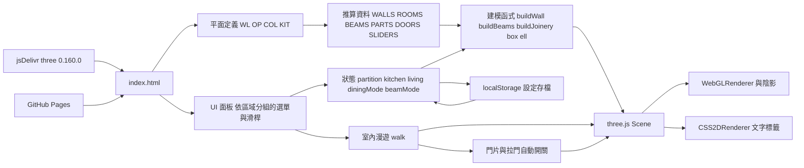
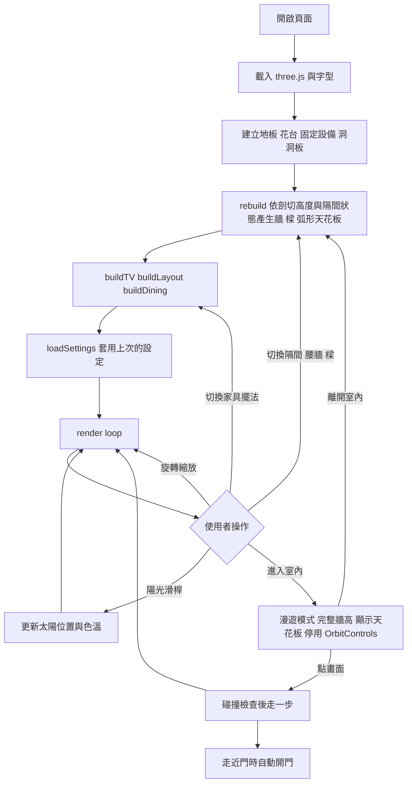

# 系統架構

單一靜態 HTML 檔，沒有後端與資料庫。牆、門窗、柱與管道間的尺寸集中在 module script 開頭的「平面定義」區塊（依客戶單元圖 PDF 量測），房間、家具、樑、門片都由它推算；單位為公分，座標沿用 Sweet Home 3D 檔（x 向東、y 向南）。使用者的設定存在瀏覽器 localStorage。

## 架構圖

## 流程圖

## 資料模型

沒有資料庫，因此沒有 ER Diagram。主要資料結構：

| 常數 | 內容 |
|---|---|
| WL / lo() / hi() | 平面定義：每道牆的中心線與厚度；lo、hi 取牆的兩側面 |
| OP / COL / KIT | 平面定義：門窗開口、柱與管道間、廚房設備尺寸 |
| WALL_H / SLAB_T / WALL_TOP | 室內淨高 330、樓板厚 15、牆頂 345 |
| BEAM_TOP / BEAM_BOTTOM | 樑頂（與牆頂切齊）、樑底離地（暫定 270） |
| WALLS | 由 WL、OP 推算的牆段：外牆面方向、端點外延、開口（門窗位置、窗台、楣樑、門窗形式） |
| BEAMS | 樑的平面範圍；ext 表示在外牆以外、用外牆磚材質 |
| PARAPETS / PLANTERS / SHAFTS / CANOPY | 女兒牆、花台、管道間與柱、陽台弧形天花板 |
| ROOMS / FLOOR_PATCHES | 房間地板矩形、材質、尺寸與面積；牆下補片與門檻 |
| PARTS | 臥室一可切換玻璃隔間的牆段 |
| LAYOUTS / DINING / TV / SOFA / COFFEE / VITRINE | 家具配置與 IKEA 尺寸 |
| CARPCAB / ENTRY_CAB / PEGBOARD | 木作吊櫃、玄關櫃、洞洞板 |
| DOORS / SLIDERS | 平開門片（鉸鏈、開啟方向）與橫拉門片，室內漫遊時自動開關 |
| SETTINGS_KEY | localStorage 設定存檔的鍵（逐欄位驗證後套用） |
