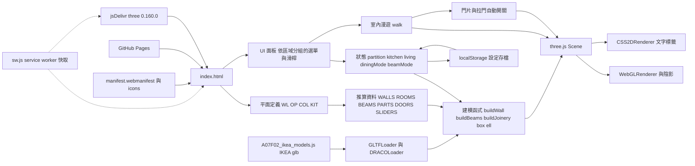
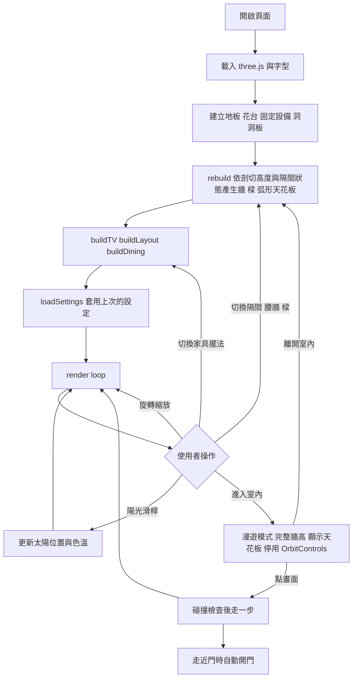

# 系統架構

單一靜態 HTML 檔，沒有後端與資料庫；另有 PWA 用的 manifest、service worker 與圖示，可加入手機主畫面並離線開啟。牆、門窗、柱與管道間的尺寸集中在 module script 開頭的「平面定義」區塊（依客戶單元圖 PDF 量測），房間、家具、樑、門片都由它推算；單位為公分，座標沿用 Sweet Home 3D 檔（x 向東、y 向南）。使用者的設定存在瀏覽器 localStorage。

## 架構圖

## 流程圖

## 資料模型

沒有資料庫，因此沒有 ER Diagram。主要資料結構：

| 常數 | 內容 |
|---|---|
| WL / lo() / hi() | 平面定義：每道牆的中心線與厚度；lo、hi 取牆的兩側面 |
| OP / COL / KIT | 平面定義：門窗開口、柱與管道間、廚房設備尺寸 |
| WALL_H / SLAB_T / WALL_TOP | 室內淨高 330、樓板厚 15、牆頂 345 |
| BEAM_TOP / BEAM_BOTTOM | 樑頂（與牆頂切齊）、樑底離地（暫定 270） |
| WALLS | 由 WL、OP 推算的牆段：外牆面方向、端點外延、開口（門窗位置、窗台、楣樑、門窗形式） |
| BEAMS | 樑的平面範圍；ext 表示在外牆以外、用外牆磚材質 |
| PARAPETS / PLANTERS / SHAFTS / CANOPY | 女兒牆、花台、管道間與柱、陽台弧形天花板（頂面齊樓板頂，底面低於室內天花板 drop，藏 VAF 排風管） |
| ROOMS / FLOOR_PATCHES | 房間地板矩形、材質、尺寸與面積；牆下補片與門檻 |
| PARTS | 臥室一可切換玻璃隔間的牆段 |
| LAYOUTS / DINING / TV / SOFA / COFFEE / VITRINE | 家具配置與 IKEA 尺寸 |
| VAF / VAF2 | 客廳與廚房天花板靜流風機（PDF 位置）：機身、進風格柵、進氣與排風管路徑、嵌在陽台天花板的出風口格柵 |
| CEIL_PIPES | 天花板明管（照片＋PDF）：平面折線、管徑、高度、末端彎頭、較低的續接段與露台天花板出風格柵（tube 畫水平圓管、soffitGrille 畫格柵） |
| LIGHTS / PENDANT | 客戶單元圖的燈具位置與類型（平頂燈、崁燈、壁燈、景觀燈、出線口）；餐廳吊燈（IKEA VÄXJÖ）的吊點、尺寸、電線長度、吊法（掛鉤繞線或出線延伸）與原出線口 |
| LIVING_N_OUTLETS / SOUTH_OUTLETS / KITCHEN_WALL_DEVICES / B1_WALL_DEVICES / MB_WALL_DEVICES | 牆上原有的開關插座；依擺法判斷是否移位（原位上色、新位置綠色）或原位重新安裝（上色＋綠框，臥室一北牆整面重做時） |
| CHECKS | 待確認數值清單（勾選狀態存 localStorage，鍵 CHECKS_KEY） |
| CARPCAB / ENTRY_CAB / PEGBOARD | 木作吊櫃、玄關櫃、洞洞板 |
| DOORS / SLIDERS | 平開門片（鉸鏈、開啟方向）與橫拉門片，室內漫遊時自動開關 |
| IKEA_MODELS / placeModel | IKEA 3D 模型（base64 glb）與擺放函式：依牆面對齊、朝向、必要時縮放；讀不到時改畫方塊 |
| SETTINGS_KEY | localStorage 設定存檔的鍵（逐欄位驗證後套用） |
| sw.js CACHE / PRECACHE / CDN_HOSTS | service worker 的快取名稱（升版用）、預先快取的同網域檔案、採 cache-first 的 CDN 網域 |
