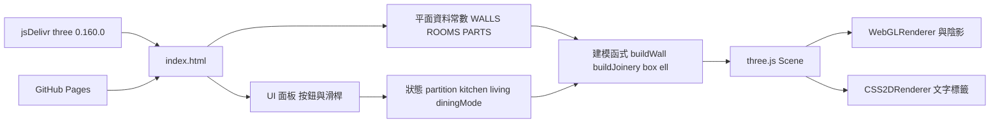
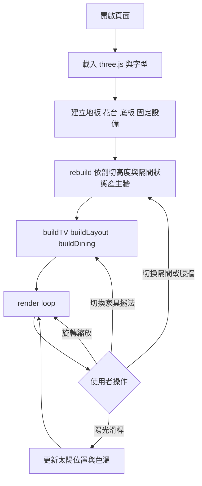

# 系統架構

單一靜態 HTML 檔，沒有後端與資料庫。所有平面資料（牆、門窗、房間、家具）以常數寫在頁面的 module script 裡，單位為公分，座標沿用 Sweet Home 3D 檔（x 向東、y 向南）。

## 架構圖

## 流程圖

## 資料模型

沒有資料庫，因此沒有 ER Diagram。主要資料結構：

| 常數 | 內容 |
|---|---|
| WALLS | 牆中心線、厚度、開口（門窗位置、窗台、楣樑、門窗形式） |
| PARAPETS / PLANTERS / SHAFTS | 女兒牆、花台、管道間 |
| ROOMS | 房間地板矩形、材質、尺寸與面積 |
| PARTS | 臥室一可切換玻璃隔間的牆段 |
| LAYOUTS / DINING / TV / SOFA / COFFEE | 家具配置與 IKEA 尺寸 |
